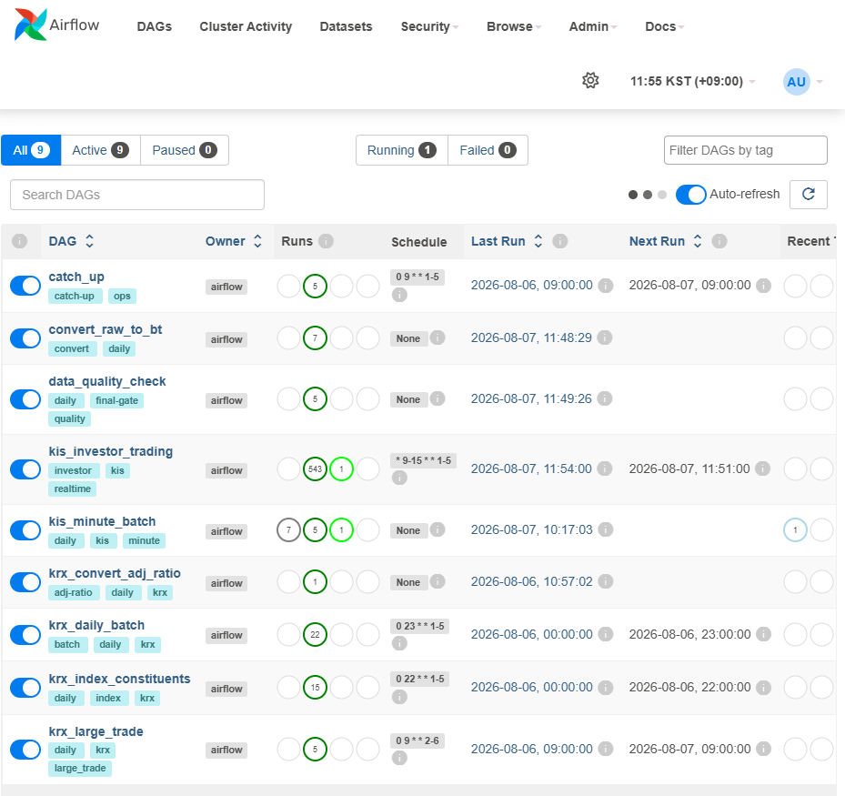
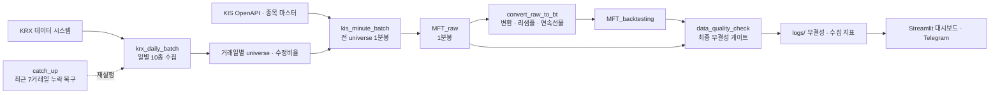

# Market Data Pipeline

한국거래소(KRX)와 한국투자증권(KIS) Open API에서 한국 주식·ETF·선물·옵션 데이터를 매일 수집해,
**백테스트에 바로 쓸 수 있는 Parquet 데이터 레이크**로 변환·검증하는 Airflow 기반 데이터 파이프라인입니다.
Docker Compose로 Airflow, PostgreSQL(메타데이터 전용), Streamlit 대시보드를 함께 띄우고, 실제로 매일 운용하고 있습니다.



- **수집:** KRX 일별 데이터 10종 + 지수 구성종목 + 대량매매, KIS 전 universe 1분봉(주식 7천여 종목, 선물·옵션 1,600여 계약), 장중 투자자 동향(매분)
- **변환:** Raw 1분봉 → 백테스트 표준 schema, 5분·15분·30분·1시간 봉, 수정주가, 연속선물
- **검증:** 거래일마다 12개 항목의 최종 무결성 게이트. 하나라도 실패하면 그날 파이프라인은 실패로 끝남
- **운영:** 성공한 단계만 다음 단계를 트리거하는 체인, 최근 7거래일 누락 자동 복구, Telegram 알림

---

## 아키텍처



**설계 원칙**

- **시장 데이터는 파일(Parquet), 실행 상태는 DB:** PostgreSQL에는 Airflow의 DAG·task 실행 메타데이터만 저장합니다. 시장 데이터의 기준 저장소는 `DATA_DB_PATH` 아래 파일 레이크입니다.
- **"파일이 만들어졌다"가 아니라 "검증까지 끝났다"가 성공 기준:** 각 단계는 산출물을 검증한 뒤에만 다음 DAG를 트리거하고, 빈 응답이나 필수 데이터 누락은 정상 skip이 아니라 실패로 처리해 불완전한 데이터가 하류로 전파되지 않게 합니다.
- **멱등성(idempotency):** 월별 파일은 고유키(`sec_code`, `trade_time`) 기준으로 병합·중복 제거하므로, 같은 날을 다시 수집해도 결과가 같습니다.
- **명시적 대상 거래일:** 모든 단계에 대상 거래일을 명시적으로 전달하고 KST로 해석합니다. Airflow의 logical date와 실제 거래일이 어긋나는 문제를 피하기 위함입니다.

---

## DAG

| DAG | 스케줄 (KST) | 역할 |
| --- | --- | --- |
| `krx_index_constituents` | 월~금 22:00 | KRX 지수 목록과 구성종목 수집 |
| `krx_daily_batch` | 월~금 23:00 | KRX 10종 수집, 수정비율 계산, 완료 검증 후 KIS 트리거 |
| `kis_minute_batch` | 트리거 | 주식·선물·옵션 전 universe 1분봉 수집 |
| `convert_raw_to_bt` | 트리거 | Raw → 백테스트 schema, 상위 timeframe, 연속선물 생성 |
| `data_quality_check` | 트리거 | 최종 무결성 게이트, 거래일별 결과 저장 |
| `kis_investor_trading` | 월~금 09:00~15:59 매분 | KOSPI/KOSDAQ 투자자별 매매 동향 |
| `catch_up` | 월~금 09:00 | 최근 7거래일을 검사해 처음 누락된 단계부터 재실행 |
| `krx_large_trade` | 화~토 09:00 | 전 영업일 대량매매 |
| `krx_convert_adj_ratio` | 수동 | 수정비율 전체 재생성·복구 |

메인 체인: `krx_daily_batch` → `kis_minute_batch` → `convert_raw_to_bt` → `data_quality_check`.
각 화살표는 앞 단계의 성공과 산출물 검증을 통과해야만 이어집니다. 같은 날짜에 이미 실행 중인 run이 있으면 재사용하고, 날짜별 재시도는 최대 3회로 제한합니다.

---

## 수집 데이터

**KRX 일별 (10종):** 코스피지수 시세추이, 전종목 등락률, 업종별 분포, 업종 분류현황, ETF 전종목 시세·등락률, 투자자별 거래실적(개별종목), 외국인 보유량, 전종목 시세, 파생 전종목 시세.
여기에 지수 구성종목(지수 160여 개)과 전일 대량매매가 추가됩니다.

**KIS 1분봉**

| 자산 | 시장 / 세션 |
| --- | --- |
| 주식·ETF | KRX 직접시장 `J` (통합시장 `UN`이 빈 응답이면 `J`로 fallback) |
| 지수·업종·변동성 선물 | 주간 `F` |
| 개별주식선물 | `JF` |
| 통화·채권·금 선물 | 주간 `CF`, 야간 `CM` |
| 지수·주식 옵션 | 주간 `O`, 야간 `EU` |

KIS는 야간 세션 시각을 `24:00~30:00` 형식으로 줍니다. 이를 다음 달력일 `00:00~06:00`으로 정규화하고, 응답의 실제 영업일 필드를 보존해 야간 데이터가 엉뚱한 거래일로 들어가지 않게 합니다.

## 저장 구조

```text
$DATA_DB_PATH
├─ MFT_archive/KR/kis_api/investor_trading_time_{kospi,kosdaq}/YYYY-MM-DD.parquet
├─ MFT_raw/KR/price/1m/{stock,future,option,continuous_future}/YYYY-MM.parquet
├─ MFT_backtesting/KR/
│  ├─ info/stock_info.parquet                       # ISIN ↔ ticker
│  ├─ krx_crawled/{수집항목}/YYYY-MM-DD.parquet
│  └─ price/{1m,5m,15m,30m,1h}/{stock,future,option}/YYYY-MM.parquet
└─ logs/
   ├─ YYYY-MM-DD_integrity.parquet                  # 무결성 게이트 결과
   ├─ kis_minute_silent_skip/YYYY-MM.parquet        # 자산별 수집 지표
   └─ kis_master/derivative_codes_YYYY-MM-DD.parquet
```

백테스트 1분봉은 `isin, datetime, open, high, low, close, volume` 공통 schema이고, 주식은 `ticker`, 수정 OHLC, `cum_adj_ratio`가 추가됩니다.
상위 봉은 시가=첫 값, 고가=최댓값, 저가=최솟값, 종가=마지막 값, 거래량=합계로 리샘플합니다.

---

## 데이터 품질 게이트

`data_quality_check`는 거래일마다 아래를 모두 통과해야 성공합니다.

1. KRX 필수 10종 파일 존재·읽기 가능·1행 이상, 지수 구성종목 1개 이상
2. 수정비율 대상일 행 존재, 모든 `cum_adj_ratio > 0`, `stock_info` schema
3. Raw 1분봉, 백테스트 1m/5m/15m/30m/1h × 주식·선물·옵션 대상일 행 존재
4. 식별자·시각 key의 null과 중복 0
5. OHLCV의 null·NaN·Inf 0, 음수 거래량 0, OHLC 논리 관계(고가 ≥ 시가·종가 ≥ 저가) 유효
6. **Raw와 백테스트 1분봉의 key 집합과 비조정 OHLCV 값 완전 일치**
7. KIS 수집 지표 3종(주식·선물·옵션)이 accepted이고, 실패·예상 누락이 허용치 이내
8. 연속선물 대상일 행 존재

결과는 거래일별 `logs/YYYY-MM-DD_integrity.parquet`에 항목별 OK/FAIL과 원인으로 남고, 대시보드에서 확인할 수 있습니다.

## 운영 안정성

| 문제 | 대응 |
| --- | --- |
| 쓰다가 죽으면 기존 월 파일이 깨짐 | 같은 폴더에 임시 파일로 쓰고 schema 재검증·fsync 후 `os.replace`로 원자 교체 |
| 여러 worker가 같은 월 파일을 동시에 갱신 | lock 파일로 read-merge-write 직렬화, 오래된 lock은 자동 정리 |
| KIS 초당 요청 제한, 일시 장애 | 전역 rate limit, timeout·retry, 연속 실패 circuit breaker |
| "빈 응답"이 정상 무거래인지 누락인지 구분 불가 | 거래 근거가 있는 종목의 빈 응답을 `unexpected_no_data`로 분리 집계하고 허용치 초과 시 실패 |
| 종목 마스터 다운로드 실패, 만기 지난 코드 | 날짜별 마스터 캐시(원자적 저장, 최소 크기 검증)와 과거 캐시 fallback, 만기 선물·주간옵션 코드 복원 |
| 며칠 장애 후 복구 | `catch_up`이 최근 7거래일을 검사해 처음 누락된 단계부터만 재실행 |
| 검증된 날짜를 다시 수집하는 낭비 | 완결성이 확인된 일자는 재수집 없이 재사용 |

수집 기간 전체의 연속성·schema 호환성 감사 결과는 [`docs/audits/`](docs/audits)에 있습니다.

---

## 실행

**요구사항:** Docker Desktop, KIS Open API 실전 앱 키(시세 조회용)

```bash
cp docker/.env.example docker/.env      # PROD_KIS_APP_KEY / PROD_KIS_APP_SECRET 입력 (Telegram은 선택)
```

데이터 볼륨(`pipeline_smb_data`)을 먼저 만듭니다.

- **로컬 폴더를 쓸 때:**
  ```bash
  docker volume create --driver local --opt type=none --opt o=bind --opt device=/absolute/path/to/data_db pipeline_smb_data
  ```
- **Windows + SMB 공유 폴더를 쓸 때:** [`scripts/setup_smb_data_volume.ps1`](scripts/setup_smb_data_volume.ps1)을 실행합니다. 자동 시작 설정은 [`scripts/windows_autostart.md`](scripts/windows_autostart.md)를 참고하세요.

```bash
cd docker
docker compose up -d --build
```

- Airflow: http://localhost:8080
- 대시보드: http://localhost:8050

**백필·감사 스크립트** (`scripts/`): 과거 KIS 분봉·KRX 이력 백필, 데이터 연속성 감사, Parquet 호환성 감사, schema 마이그레이션.

## 테스트

Airflow 없이도 돌아가도록 테스트에서는 Airflow를 가짜 모듈로 대체합니다.

```bash
pip install -r requirements-dev.txt
pytest
```

원자적 저장과 lock, 타임존과 대상 거래일, 누락 탐지와 트리거 순서, KIS 시장 fallback·마스터 캐시·circuit breaker, 야간 세션 시각, 수정비율, 데이터 품질 검사 등 119개 테스트가 있습니다.

---

## 디렉터리

```
dags/                 # Airflow DAG (9개) + lib/ (파이프라인 트리거, 누락 탐지, 실패 콜백)
packages/
  mft_krx/            # KRX 크롤러, 인증, 수정비율·크롤링 데이터 변환
  mft_kis/            # KIS REST 클라이언트, 토큰 관리, 분봉 fetcher, universe 구성
  mft_koscom/         # Raw → 백테스트 변환, 리샘플, 연속선물
  mft_common/         # KRX 거래일 캘린더, 원자적 Parquet 저장·lock
dashboard/            # Streamlit 운영 대시보드
docker/               # Dockerfile, docker-compose, .env.example
scripts/              # 백필 · 감사 · 마이그레이션 · 운영 설정
docs/                 # 운영 보고서, 데이터 감사 결과
tests/
```

## 이용 조건

포트폴리오 검토용으로 공개한 저장소입니다. 코드와 문서의 복제, 수정, 재배포, 상업적 이용 및 실거래 사용을 허락하지 않습니다. 자세한 내용은 [LICENSE](LICENSE)를 참고하세요.

이 저장소에는 시장 데이터가 포함되어 있지 않습니다. 코드로 KRX·KIS 데이터를 수집할 때는 각 기관의 이용약관과 호출 제한을 따라야 합니다.
