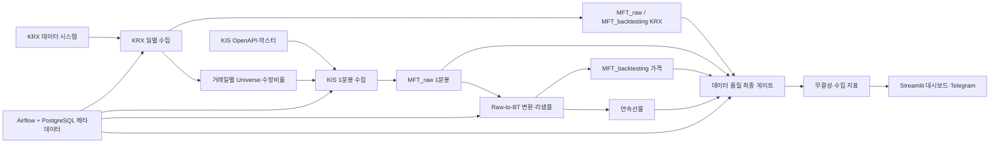
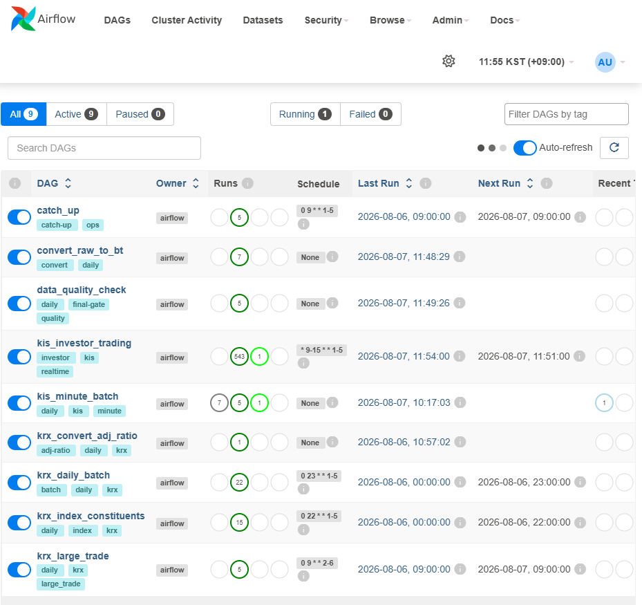

# 데이터 파이프라인 운영 현황 보고서 (2026-08)

- 보고 기준: 2026-08-07 11:10 KST 스냅샷

## 1. 요약

이 파이프라인은 한국거래소(KRX)와 한국투자증권(KIS)에서 한국 주식·ETF·선물·옵션 및 시장 보조 데이터를 수집하고, 이를 연구·백테스트에 사용할 수 있는 Parquet 데이터로 변환·검증하는 로컬 데이터 플랫폼이다. Airflow가 수집 순서와 재처리를 관리하고, PostgreSQL은 Airflow 실행 메타데이터만 저장하며, 실제 시장 데이터는 파일 기반 데이터 레이크에 저장한다.

현재 Docker 운영 스택은 정상 기동 중이고, 지원 DAG 9개는 모두 활성 상태이며 import error는 0건이다. 현재 소스 기준 전체 자동화 테스트는 **115개 전부 통과**했다. 2026-08-04 거래일은 KRX → KIS → Raw-to-BT 변환 → 데이터 품질 검사까지 실제 전 구간 성공이 확인됐다. 2026-08-06 KRX 일별 수집도 성공했고, 2026-07-27부터의 과거 누락분은 순차 복구 중이다.

종합 판정은 다음과 같다.

| 영역 | 판정    | 핵심 근거 |
|---|---------|---|
| Docker/Airflow 운영 | 정상    | PostgreSQL healthy, Airflow webserver healthy, scheduler/dashboard 실행 중 |
| DAG 로딩 | 정상    | 지원 DAG 9개 활성, import error 0 |
| 자동화 검증 | 정상    | `115 passed in 7.35s` |
| 최신 실데이터 E2E | 정상    | 2026-08-04 전체 체인 success, 최종 무결성 FAIL 0 |
| KRX 최신 수집 | 정상    | 2026-08-06 기준 KRX 10종 및 지수 구성 데이터 존재 |
| 과거 데이터 복구 | 진행 중 | 2026-07-27 KIS 재수집 running, 후속 날짜 8건 queued |


## 2. 시스템 목적과 업무 범위

이 파이프라인의 업무 범위는 크게 다섯 단계다.

1. KRX의 종가·등락률·업종·ETF·수급·파생·지수 데이터를 일별 수집한다.
2. KRX와 KIS 마스터를 결합해 거래일별 주식·선물·옵션 universe를 만든다.
3. KIS OpenAPI에서 전 universe의 1분봉을 수집한다.
4. Raw 데이터를 백테스트 표준 schema로 변환하고 5분·15분·30분·1시간 봉, 수정주가, 연속선물을 생성한다.
5. 완결성·중복·OHLCV·Raw/BT 일치 여부를 검사하고 결과를 대시보드와 알림(Telegram)에 제공한다.



PostgreSQL에는 시장 데이터가 아니라 DAG, task, 실행 상태 등 Airflow 메타데이터가 저장된다. 시장 데이터의 기준 저장소는 `DATA_DB_PATH`가 가리키는 호스트 디렉터리이며 Docker 내부에서는 `/data_db`로 mount된다.

## 3. 수집 데이터 상세

### 3.1 KRX 일별 데이터

`krx_daily_batch`는 아래 10종을 거래일별로 순차 수집한다. 표의 행 수는 2026-08-06 실제 최신 파일 기준이다.

| 수집 항목 | 주요 용도 | 2026-08-06 행 수 |
|---|---|---:|
| 코스피지수시세추이 | KOSPI 종가·OHLC·거래량·시가총액 | 1 |
| 전종목등락률 | 종목별 기준가·종가·등락률, 수정비율 원천 | 2,763 |
| 업종별분포 | 업종별 회사·종목 수, 시가총액·거래 비중 | 52 |
| 업종분류현황 | 종목별 시장·업종 분류와 시가총액 | 2,763 |
| ETF전종목시세 | ETF OHLC·NAV·거래·기초지수 정보 | 1,160 |
| ETF전종목등락률 | ETF 기준가·종가·등락률 | 1,160 |
| 투자자별거래실적개별종목 | 개인·외국인·기관 세부 주체별 순매매 | 2,763 |
| 외국인보유량 | 외국인 보유수량·지분율·한도소진율 | 2,763 |
| 전종목시세 | 주식 전 종목 OHLCV·거래대금·시가총액 | 2,872 |
| 파생전종목시세 | 선물·옵션 종가·OHLC·거래량·미결제약정 | 15,035 |

수집 파일에는 데이터셋에 따라 `date`, `sec_code` 또는 종목코드, 종목명, 시장 구분과 각 시장 통계가 저장된다. 비어 있는 결과는 정상 skip으로 취급하지 않고 DAG를 실패시켜 불완전한 universe가 KIS 수집으로 전파되지 않게 한다.

별도 KRX 데이터는 다음과 같다.

- `krx_index_constituents`: 2026-08-06 기준 지수 163개, 구성종목 합계 21,981행
- `krx_large_trade`: 2026-08-06 기준 전일 대량매매 18행
- 지수 구성종목은 `지수구성종목/{지수명}/YYYY-MM-DD.parquet` 구조로 지수별 분리 저장

### 3.2 KIS 분봉 데이터

KIS에서는 거래일별 전 universe를 대상으로 다음 1분봉을 수집한다.

| 자산 | 수집 내용 | 시장/세션 처리 |
|---|---|---|
| 주식·ETF | 종목별 1분 OHLCV | KRX 직접시장 `J`; `UN` 빈 응답 시 `J` fallback |
| 지수·업종·변동성 선물 | 개별 계약 1분 OHLCV | 주간 `F` |
| 개별주식선물 | 개별 계약 1분 OHLCV | `JF` |
| 통화·채권·금 선물 | 개별 계약 1분 OHLCV | 주간 `CF`, 야간 `CM` |
| 지수·주식 옵션 | 개별 종목 1분 OHLCV | 주간 `O`, 야간 `EU` |

2026-07-27 복구 실행의 실제 universe 스냅샷은 주식 7,318개, 지수선물 125개, 주식선물 368개, 지수옵션 1,175개였다. 이 수치는 거래일과 마스터 상태에 따라 달라진다.

KIS의 장외·야간 세션은 24:00~30:00 형식의 시간을 반환할 수 있다. 현재 코드는 이를 다음 달력일의 00:00~06:00으로 정규화하고, KIS 응답의 실제 영업일 필드를 보존한다. 야간시장 `CM`·`EU`는 조회일과 KRX 대상 영업일이 다를 수 있어 세션 영업일을 기준으로 필터링한다.

### 3.3 장중 투자자 동향

`kis_investor_trading`은 평일 09:00~15:59 매분 KOSPI와 KOSDAQ의 투자자 매매 동향을 수집한다. 파일은 다음 위치에 일별 저장된다.

- `MFT_archive/KR/kis_api/investor_trading_time_kospi/YYYY-MM-DD.parquet`
- `MFT_archive/KR/kis_api/investor_trading_time_kosdaq/YYYY-MM-DD.parquet`

### 3.4 파생·보조 산출 데이터

- 주식 수정비율: `전종목등락률` 일별 파일을 표준화해 `adj_ratio`, `cum_adj_ratio`를 계산
- 종목 매핑: `stock_info.parquet`에 `isin`, `ticker` 저장
- 연속선물: 개별 선물 계약에서 상품별 대표 계약을 선택해 월별 생성
- KIS master cache: 다운로드 장애에 대비한 날짜별 파생 단축코드 캐시
- silent-skip 지표: 자산별 성공·실패·정상 무거래·예상 누락을 구분
- 무결성 로그: 거래일별 모든 품질 검사의 OK/FAIL 결과와 상세 원인
- 복구 백업: 중복 옵션 데이터 정리 전 원본을 별도 보존

## 4. 데이터 저장 구조와 Schema

### 4.1 디렉터리 구조

```text
/data_db
├─ MFT_archive/KR/kis_api/
│  ├─ investor_trading_time_kospi/YYYY-MM-DD.parquet
│  └─ investor_trading_time_kosdaq/YYYY-MM-DD.parquet
├─ MFT_raw/KR/price/1m/
│  ├─ stock/YYYY-MM.parquet
│  ├─ future/YYYY-MM.parquet
│  ├─ option/YYYY-MM.parquet
│  └─ continuous_future/YYYY-MM.parquet
├─ MFT_backtesting/KR/
│  ├─ info/stock_info.parquet
│  ├─ krx_crawled/{수집항목}/YYYY-MM-DD.parquet
│  ├─ krx_crawled/전종목등락률/YYYY-MM.parquet
│  └─ price/{1m,5m,15m,30m,1h}/{stock,future,option}/YYYY-MM.parquet
└─ logs/
   ├─ YYYY-MM-DD_integrity.parquet
   ├─ kis_minute_silent_skip/YYYY-MM.parquet
   ├─ kis_master/derivative_codes_YYYY-MM-DD.parquet
   └─ repair_backups/
```

### 4.2 Raw 가격 Schema

주식 Raw 1분봉은 다음 필드를 사용한다.

| 필드 | 의미 |
|---|---|
| `sec_code` | ISIN 기반 증권 식별자 |
| `ticker` | KIS 단축코드; 주식에 포함 |
| `trade_time` | 정규화한 체결 시각 |
| `open_price`, `high_price`, `low_price`, `close_price` | 비조정 OHLC |
| `trade_volume` | 분 거래량 |

선물·옵션은 동일 구조에서 `ticker` 없이 `sec_code`, `trade_time`, OHLCV를 저장한다. 월 파일은 `(sec_code, trade_time)`를 고유키로 병합·중복 제거한다.

### 4.3 Backtesting 가격 Schema

Backtesting 1분봉은 `isin`, `datetime`, `open`, `high`, `low`, `close`, `volume`의 공통 schema로 변환된다. 주식에는 다음 필드가 추가된다.

- `ticker`
- `adj_open`, `adj_high`, `adj_low`, `adj_close`
- `cum_adj_ratio`

1분봉으로부터 5분·15분·30분·1시간 봉을 생성하며, 시가=구간 첫 값, 고가=최댓값, 저가=최솟값, 종가=마지막 값, 거래량=합계 규칙을 사용한다.

### 4.4 파일 저장 안전성

월별 파일 갱신은 다음 순서로 처리한다.

1. 기존 파일과 신규 데이터를 읽어 고유키 기준 병합한다.
2. 대상 파일과 같은 디렉터리에 임시 Parquet를 쓴다.
3. schema와 파일을 재검증하고 fsync한다.
4. `os.replace`로 원자 교체한다.
5. lock file로 동시 read-merge-write를 직렬화한다.

중간 실패 시 기존 정상 파일이 손상되는 것을 방지하며, 재수집도 같은 키의 최신 행만 남기므로 idempotent하게 동작한다.

### 4.5 현재 보유 데이터 스냅샷

| 영역 | Parquet 수 | 용량 | 행 수/비고 |
|---|---:|---:|---|
| `MFT_archive` | 12 | 약 0.001 GiB | 장중 투자자 동향 중심 |
| `MFT_raw` | 12 | 약 0.078 GiB | 주식 5,286,117행, 선물 816,153행, 옵션 223,862행, 연속선물 11,271행 |
| `MFT_backtesting` | 26,283 | 약 1.022 GiB | 가격 산출물 40파일·6,746,515행, 다수의 지수별 구성종목 파일 포함 |
| `logs` | 26 | 약 0.002 GiB | 무결성·KIS 지표·마스터·복구 로그, 총 136,773행 |

추가 현황:

- `stock_info.parquet`: 4,113개 ISIN-ticker 매핑
- 2026-08 Raw 월 파일: 주식 1,095,497행, 선물 167,418행, 옵션 54,180행
- 2026년 수정비율 월 파일 8개(1~8월): 현재 합계 352,813행
- 2026-08-06 KRX 일별 데이터와 지수 구성종목까지 실제 파일 존재 확인

위 수치는 2026-08-07 11:10 KST 전후의 동적 스냅샷이다. 백필이 실행 중이므로 행 수와 파일 수정 시각은 계속 증가할 수 있다.

## 5. Airflow 운영 구조

### 5.1 지원 DAG와 스케줄

| DAG | 스케줄(KST) | 역할 |
|---|---|---|
| `krx_index_constituents` | 월~금 22:00 | KRX 지수 목록과 구성종목 수집 |
| `krx_daily_batch` | 월~금 23:00 | KRX 10종 수집, 수정비율 계산, KIS trigger |
| `kis_minute_batch` | trigger only | 주식·선물·옵션 전 universe 1분봉 수집 |
| `convert_raw_to_bt` | trigger only | Raw→BT, 상위 timeframe, 연속선물 생성 |
| `data_quality_check` | trigger only | 최종 무결성 게이트와 결과 저장 |
| `kis_investor_trading` | 월~금 09:00~15:59 매분 | KOSPI/KOSDAQ 투자자 동향 |
| `catch_up` | 월~금 09:00 | 최근 7거래일 누락 검사 및 최초 누락 단계 재실행 |
| `krx_large_trade` | 화~토 09:00 | 전 영업일 대량매매 수집 |
| `krx_convert_adj_ratio` | 수동 | 수정비율 전체 재생성·복구 |

### 5.2 메인 실행 체인

```text
krx_daily_batch
  └─ 성공 및 산출물 검증
     └─ kis_minute_batch
        └─ 실패·예상누락 0 및 저장 검증
           └─ convert_raw_to_bt
              └─ 1m/5m/15m/30m/1h 및 연속선물 검증
                 └─ data_quality_check
```

각 단계는 `dag_run.conf`로 명시적 대상 거래일을 전달한다. 단순 시간 예약에 의존하지 않고 선행 단계의 성공과 산출물 존재를 확인한 뒤 다음 단계를 실행한다. 각 DAG는 `max_active_runs=1`로 날짜별 처리를 직렬화한다.


### 5.3 현재 운영 상태

컨테이너 상태:

- PostgreSQL 16: Up, healthy
- Airflow webserver: Up, healthy, 8080 포트
- Airflow scheduler: Up
- Streamlit dashboard: Up, 8050 포트
- Airflow init: 정상 종료 code 0
- Airflow: 2.10.4, LocalExecutor, Asia/Seoul

Airflow 누적 실행 메타데이터 스냅샷:

| DAG | success | failed | running | queued |
|---|---:|-------:|---:|---:|
| `krx_daily_batch` | 22 |      0 | 0 | 0 |
| `kis_minute_batch` | 4 |      0 | 1 | 8 |
| `convert_raw_to_bt` | 6 |      0 | 0 | 0 |
| `data_quality_check` | 4 |      0 | 0 | 0 |
| `krx_convert_adj_ratio` | 1 |      0 | 0 | 0 |


## 6. 보강 작업 내역

### 6.1 운영 기반과 배포 설정

- Docker Compose를 Airflow 2.10.4 + LocalExecutor + PostgreSQL 16 구조로 정비
- `TZ`와 Airflow 기본 timezone을 `Asia/Seoul`로 통일
- KIS timeout·retry·실패 허용치·silent-skip 경고율을 환경변수화
- DNS resolver, restart policy, Airflow webserver healthcheck 추가
- `.env.example`, Telegram 설정, Windows 자동 시작 문서 추가
- DAG·packages·config·tests·data·logs volume mount 정리

### 6.2 DAG 오케스트레이션

- KRX → KIS → 변환 → 품질 검사의 success-driven trigger 체인 구축
- 모든 단계에 명시적 대상 거래일 전달 및 KST 날짜 해석 적용
- 필수 산출물 미존재·empty 시 후속 DAG 차단
- `catch_up`을 추가해 최근 7거래일의 최초 누락 단계만 자동 재실행
- 중복 active run 재사용, 날짜별 최대 3회 bounded retry 적용
- `krx_convert_adj_ratio`, `krx_large_trade` 신규 추가
- Airflow 3/사내 전용 draft를 `.airflowignore`로 지원 범위에서 분리
- 실패 callback과 Telegram 알림 안전성 강화

### 6.3 KRX 수집·수정비율

- KRX 인증 및 OTP/응답 처리 모듈 보강
- 10종 크롤러의 empty response와 변환 실패를 명시적 실패 처리
- 일별 `전종목등락률`에서 표준 월별 수정비율·누적 수정비율 생성
- `stock_info.parquet` 자동 생성·schema 검증
- 일일 KRX 완료 검증 후에만 KIS 실행
- 지수 구성종목, 투자자별 거래, 대량매매 수집 안전성 강화

### 6.4 KIS 분봉 수집

- 주식·ETF 시장 코드 `J` 교정 및 fallback
- 파생상품 시장/주간/야간 세션별 universe 보존
- 만기 선물·주간옵션 코드 복원과 KIS master 날짜별 원자 캐시
- master 최소 크기 검증과 다운로드 실패 시 과거 캐시 fallback
- API timeout/retry, rate limit, 연속 실패 circuit breaker 강화
- 거래 근거가 있는 종목의 빈 응답을 `unexpected_no_data`로 분리
- 실패·예상 누락 0을 요구하는 엄격한 완결성 게이트 적용
- response 영업일, 야간 조회일 경계, 24~30시 timestamp 처리
- OHLC envelope 정규화와 월별 고유키 deduplication
- 검증된 주식 일자는 재수집 없이 안전하게 재사용

### 6.5 변환·품질·관측

- Raw 1분봉 3개 자산의 대상일 존재를 변환 전에 검사
- 주식 수정주가와 ticker mapping 검증 강화
- 5m/15m/30m/1h 전체 리샘플 및 연속선물 결과를 후속 trigger 전에 검사
- Raw/BT 1분봉의 key 집합과 비조정 OHLCV 값까지 완전 비교
- null, duplicate, NaN/Inf, 음수 거래량, OHLC 논리 관계 검사
- KIS asset metric 3종의 accepted·failed·unexpected 상태 검사
- 일별 integrity Parquet 저장
- Streamlit에 최신일, 최근 무결성 실패, 데이터 용량, row 추이, silent-skip, 누락 캘린더 추가

### 6.6 테스트 확대

추가된 테스트는 다음 영역을 포함한다.

- 원자적 파일 저장과 lock
- timezone·logical date·명시적 대상일
- 누락 탐지와 파이프라인 trigger 순서
- KIS 시장 fallback, master 캐시, 만기 코드 복원, circuit breaker
- 야간 영업일과 24~30시 timestamp
- KRX 수정비율과 일일 완료 검증
- 중복·OHLCV·Raw/BT 데이터 품질
- Telegram 실패 안전성

## 7. 품질 관리 체계

최종 `data_quality_check`는 거래일마다 다음을 확인한다.

1. KRX 필수 10종 일별 Parquet의 존재, 읽기 가능, 1행 이상
2. 지수 구성종목 파일 1개 이상
3. 수정비율 대상일 행 존재 및 모든 `cum_adj_ratio > 0`
4. `stock_info`의 `isin`, `ticker` schema
5. Raw 1m의 stock/future/option 대상일 행
6. BT 1m/5m/15m/30m/1h × 3개 자산의 대상일 행
7. 식별자·시각 key null 및 duplicate 0
8. OHLCV null·NaN·Inf 0, 음수 거래량 0, 유효한 OHLC envelope
9. Raw와 BT 1m의 key와 비조정 OHLCV 완전 일치
10. 주식 ticker 누락 0, 수정비율 유효
11. KIS 수집 metric 3개 자산 존재, accepted=true, 실패와 예상 누락이 허용치 이내
12. 연속선물 대상일 행 존재

한 항목이라도 실패하면 DAG 전체가 failed가 되고 거래일별 integrity 파일에 원인이 남는다. 이 설계는 “파일이 만들어졌음”이 아니라 “수집·변환·논리 검증이 모두 완료됐음”을 성공 기준으로 삼는다.

